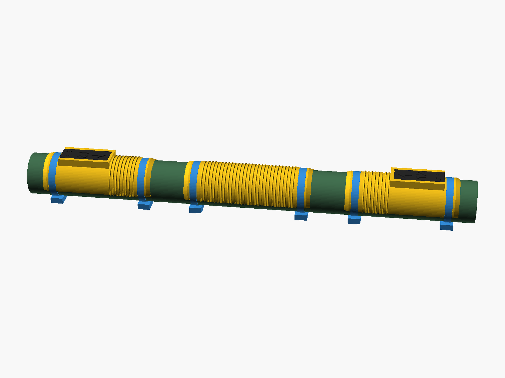
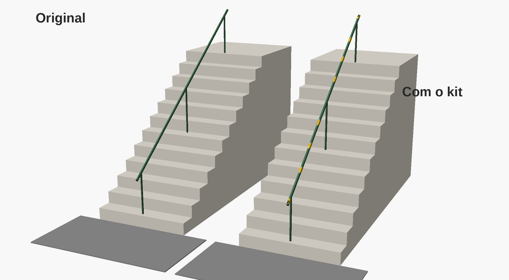
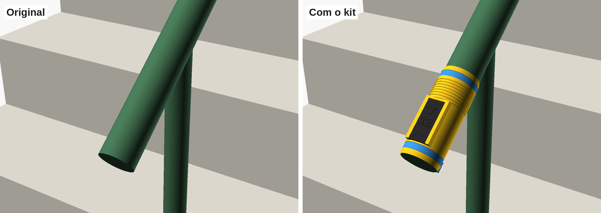
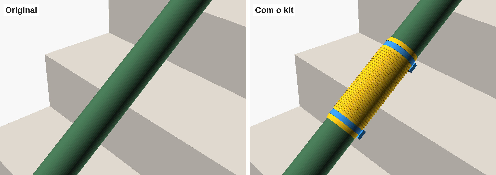
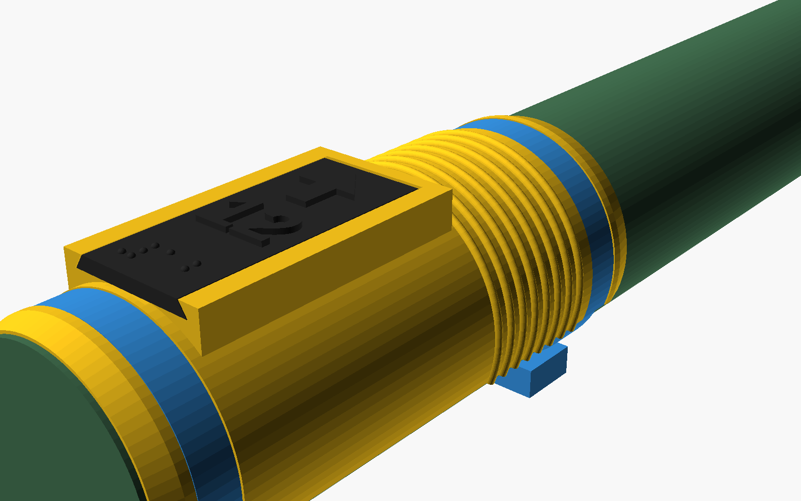

# Kit de Pega Tátil para Corrimão



Capas impressas em 3D que encaixam em qualquer corrimão redondo, sem obra e sem ferramenta. O kit dá atrito para quem precisa de apoio firme e sinaliza pelo tato onde a escada começa e termina, com seta, número de degraus e braille nas medidas da NBR 9050.

Projeto da disciplina **Project-Based Maker Lab**, FIAP Global Solution 2026.2, "CitizenTech: Cidade remodelada".

- **MakerWorld (kit, com Customizer):** https://makerworld.com/en/models/3593710-parametric-handrail-tactile-grip-kit 
- **MakerWorld (gabarito, corte a laser):** https://makerworld.com/en/models/3593670-handrail-diameter-gauge 

## O problema

O corrimão central da escada maior da Praça Piemonte, no Cipava, em Osasco (SP), é um tubo de ferro liso de 50 mm, sem nenhuma sinalização. Com chuva, a mão escorrega. Quem não enxerga não sabe onde a escada começa nem onde termina. A escada tem 12 degraus, e quem mais a usa são moradores idosos do bairro.







## As peças

| Peça | Função | Arquivo para imprimir |
|---|---|---|
| **Terminal** | Vai nas duas pontas do corrimão. A mesma peça serve em cima e embaixo. | `stl/terminal.stl` |
| **Plaquinha tátil** | Seta, número de degraus em relevo e em braille. Desliza num trilho do terminal e fica presa pela abraçadeira. | `stl/placa_tatil.stl` |
| **Pega de meio** | Anéis de textura para dar atrito entre os postes. Repita quantas precisar. | `stl/pega_meio.stl` |
| **Gabarito de diâmetro** | Placa com um "V" e escala de 20 a 60 mm, para medir o tubo antes de imprimir. | `laser/gabarito_laser.svg` ou `stl/gabarito_diametro_3d.stl` |
| **Fatias de teste** | Testam o encaixe em "C" com abraço de 200°, 220° e 240° antes de imprimir o kit. | `stl/teste_encaixe_*.stl` |

Os STLs prontos são para tubo de 50 mm e escada de 12 degraus. Para outro corrimão, use o Customizer.



## Como usar

1. **Meça o tubo** com o gabarito: encoste o "V" no corrimão e leia o número onde ele toca.
2. **Gere as peças:** no Customizer do MakerWorld, ou abrindo `cad/kit_pega_tatil.scad` no [OpenSCAD](https://openscad.org), digite o diâmetro e o número de degraus.
3. **Teste o encaixe:** imprima uma fatia de teste. Se ficar frouxa, aumente o `abraco`. Se rachar ao encaixar, diminua.
4. **Imprima** o kit e as abraçadeiras.
5. **Instale:** encaixe cada capa com a abertura para baixo, passe as abraçadeiras pelos canais com a cabeça embaixo do tubo, aperte e corte a sobra.

## Impressão

| Peça | Posição | Material | Camada |
|---|---|---|---|
| Terminal e pega de meio | em pé (tubo na vertical), com brim | PETG | 0,2 mm |
| Plaquinha | deitada, braille para cima | PETG | 0,12 mm |
| Abraçadeira | como o autor indica | PETG | 0,2 mm |

Para instalação definitiva ao ar livre, use ASA: o PETG amolece no sol forte.

**Gabarito a laser:** MDF ou acrílico de 3 mm. No `gabarito_laser.svg`, vermelho é corte e preto é gravação. Os mesmos traços estão separados em DXF e SVG na pasta `laser/`.

## Fixação reutilizável

Cada peça tem dois canais de abraçadeira, que impedem a capa de girar quando alguém apoia o peso. Recomendamos a abraçadeira reutilizável impressa **"Improved Reusable Zip Ties"**, de Doug Joseph (design8studio), na versão de 252 mm:
https://www.printables.com/model/935485-improved-new-reusable-zip-ties-4-lengths-to-choose (licença CC BY-NC 4.0, não incluída neste repositório).

A catraca abre com a mão, então você retira, troca e reinstala as peças sem gerar lixo. O canal também aceita abraçadeira de nylon comum de até 8,5 mm.

## Arquivos

```
cad/
  kit_pega_tatil.scad      kit paramétrico (terminal, plaquinha e pega de meio)
  corrimao_original.scad   CAD do corrimão da Praça Piemonte, com e sem o kit
  gabarito_diametro.scad   gabarito de diâmetro (gera o corte a laser e a versão 3D)
  teste_encaixe.scad       fatia de teste do encaixe em "C"
stl/                       peças prontas para imprimir (tubo de 50 mm, 12 degraus)
laser/                     gabarito em SVG e DXF
imagens/                   renders do original e do redesign
```

`corrimao_original.stl` serve só para visualizar o corrimão: o tubo tem quase 5 m.

## Limites

- O kit só serve para corrimão redondo.
- A NBR 9050 pede corrimão de 30 a 45 mm de diâmetro. O kit é uma capa fina, então em tubos acima de uns 38 mm ele passa desse limite, e o arquivo avisa. Ele melhora o atrito e a sinalização, mas não corrige o diâmetro do tubo.
- A instalação em espaço público depende de autorização do órgão responsável.

## Equipe

Caio Freitas - RM553190 | Caio Hideki - RM553630 | Jorge Booz - RM552700 | Mateus Tibão - RM553267 | Lana Andrade - RM552596

## Licença

[CC BY 4.0](LICENSE): você pode usar, adaptar e fabricar o kit, inclusive para fins comerciais, desde que dê crédito.
